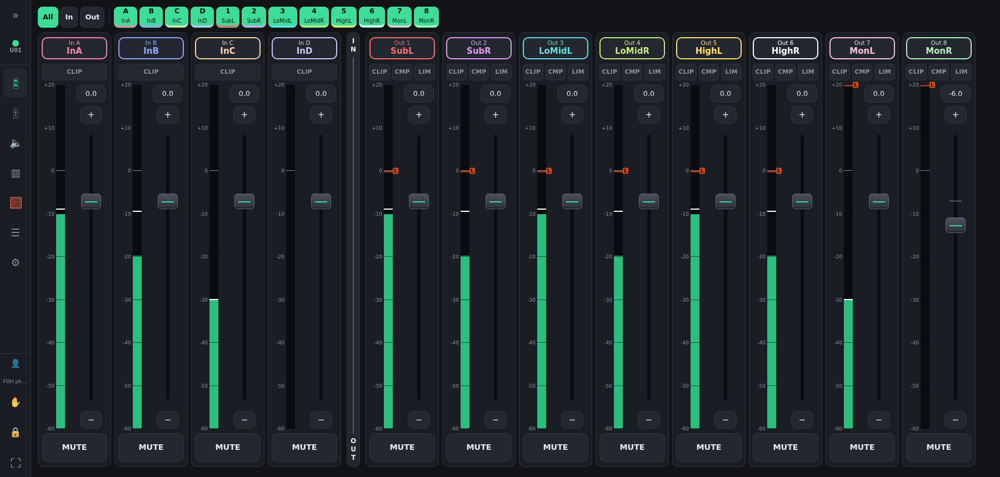
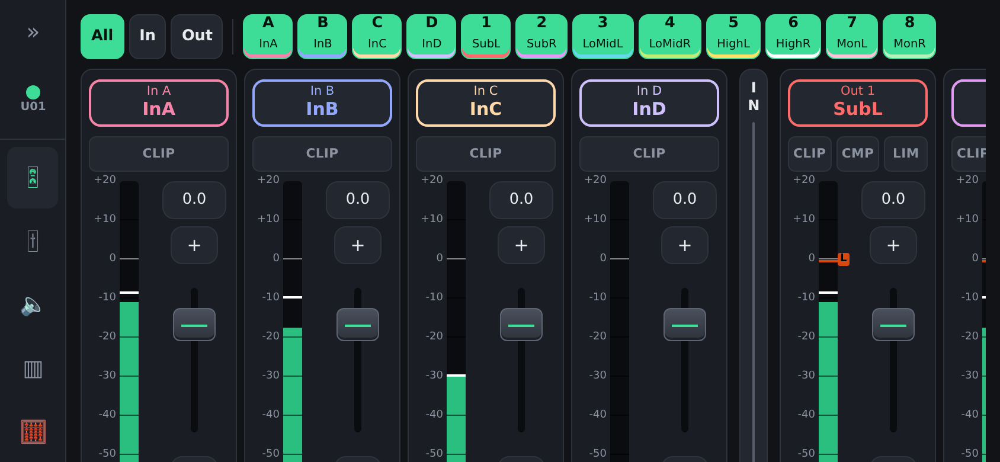
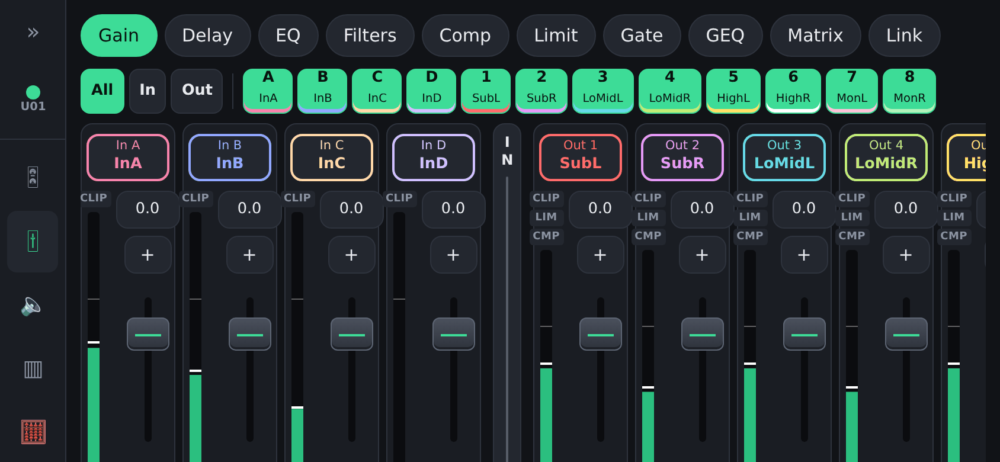
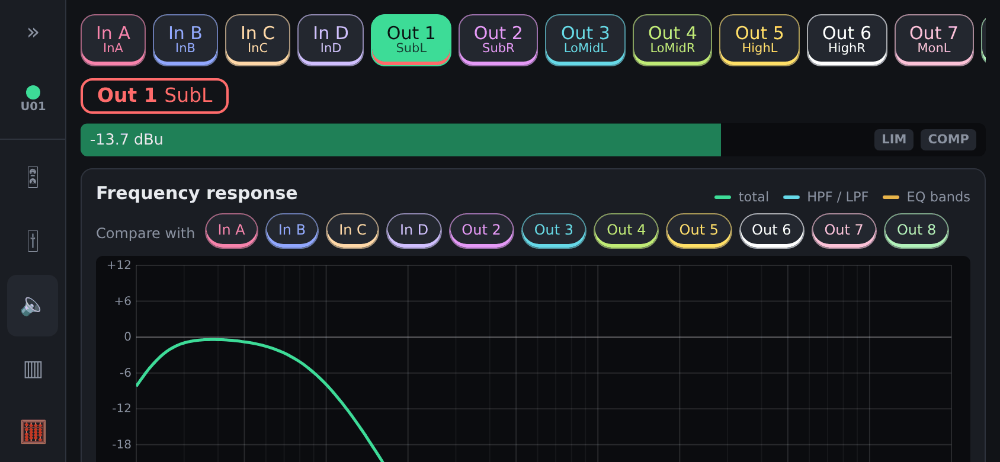
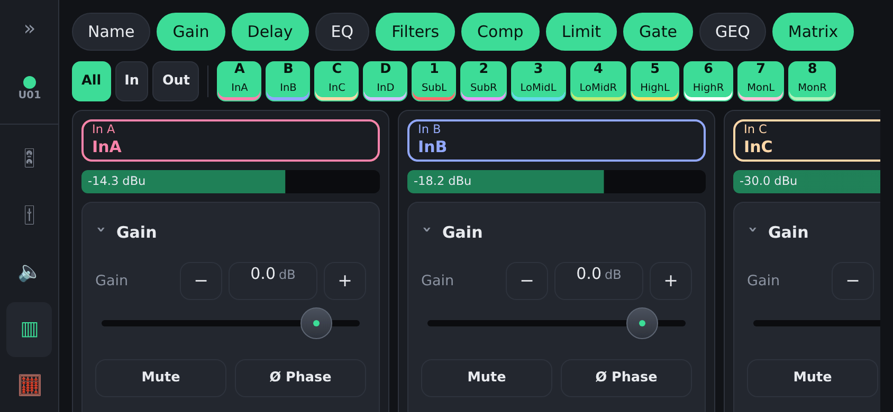
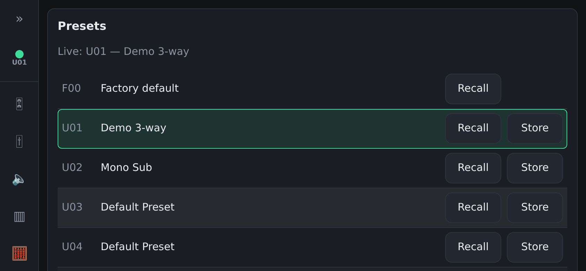
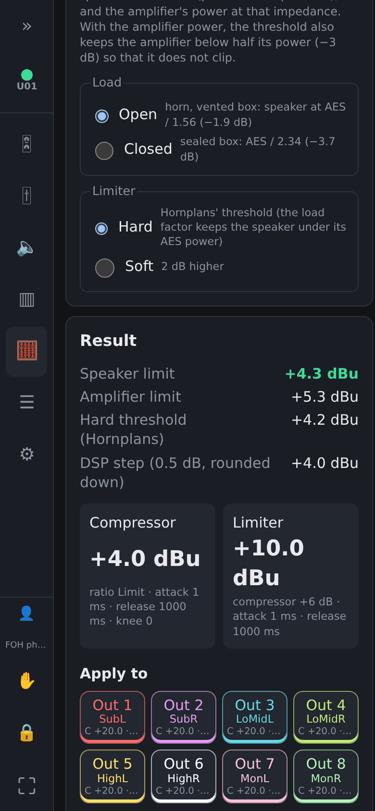

# tracks-dsp-controller

Self-hosted web app to control a **t.racks DSP 408, 206 or 204** over the network from several
browsers at once (computers, tablets, phones), with live metering. The model is detected
automatically.

One backend process owns the TCP connection to the DSP. It serves a web UI, which also works on
phones, to every client on the local network and keeps them in sync in real time. It works fully
offline.

> [!WARNING]
> **Unofficial software.** This project is not affiliated with, endorsed by or supported by
> Thomann, t.racks or Musicrown. The DSP protocol was reverse-engineered; the official editor
> remains the reference.
>
> **Vibe-coded.** Most of the code and documentation was written by an AI coding assistant
> (Claude Code), directed, reviewed and tested by a human on a real DSP 408. It is tested
> (unit, end-to-end and against hardware), but it has not been audited line by line.
>
> A DSP drives amplifiers and speakers: a wrong value can be loud or damage equipment. Try it
> on the simulator or on a spare preset first, keep backups of your presets, and use it at your
> own risk. The software comes with **no warranty** ([AGPL-3.0](LICENSE), sections 15–16).

Try it without a DSP: `uv run tracks-dsp-controller --demo`, then open http://localhost:8080 (code
`0000`).

## Screenshots

Taken in demo mode (simulated DSP 408).



On a phone, in landscape:

| Live | Params (gain strips) |
| :---: | :---: |
|  |  |
| **Channel page** | **All-in-one** |
|  |  |
| **Presets** | **Limiter calculator** |
|  |  |

## Features

- Gain, mute, phase, 4 → 8 routing matrix, PEQ (8 bands on inputs, 9 on outputs), high/low-pass
  filters and delay (in ms and metres) on every channel, compressor and limiter on outputs, noise
  gate and 31-band GEQ on inputs, channel names
- Channel links, as on the DSP: linked channels follow each other. Optionally (Settings ›
  *Merge linked channels*), a link group shows as one channel ("Out 1+5") in every view except
  Params › Matrix and Link; names and routing stay per channel
- A colour per channel, the same in every view; linked channels share the colour of the
  lowest-numbered channel of their group
- Frequency response graph on each channel page (filters, PEQ, GEQ), with other channels' curves
  as an overlay. The PEQ bands are edited on it: drag a band's marker for its frequency
  (horizontally) and gain (vertically), turn the mouse wheel over it for its Q
- Limiter calculator: compressor and limiter thresholds from the amplifier gain and the speaker
  power, impedance and load
- DSP presets U01–U20: recall, store, rename, with an "unsaved changes" indicator
- Preset files (`.prs`) of the official t.racks editor: export the live setup, import a file
  into it (and store it in a slot). The outputs are muted while a file loads
- Live meters per channel (level, peak, clip, limiter and compressor indicators), 5 Hz by default,
  adjustable from 1 to 10 Hz
- Multi-client: last writer wins by default. A client can **take control**: the others become
  read-only while it is active (released after 120 s of inactivity)
- **Master**: one client can become master (Settings) and then disconnect another client (back to
  the login screen) and block new connections; browsers already connected stay connected. The
  block ends with the role (released, logged out, or the app closed for 5 minutes)
- **Disconnect from DSP and shutdown** (Settings): frees the DSP cleanly (it accepts one program
  at a time, e.g. before opening the t.racks editor) and stops the server, for everyone. With
  Docker Compose the container then stays stopped (`restart: on-failure`)
- **Lock screen**: this browser becomes read-only and stays on the current view (everything
  stays readable, meters included) until *Unlock screen* and the access code, for a computer or
  phone left unattended; a reload stays locked
- Survives an unstable network: a heartbeat detects a dead link within ~12 s, every browser
  reconnects by itself (at once when a phone wakes up or the Wi-Fi comes back) and the server
  reconnects to the DSP. Towards the DSP the command timeout adapts to the measured round trip
  (a Wi-Fi bridge or a VPN is fine), late answers are never taken for the next command's, and
  an operation that fails half-way makes the server re-read the DSP rather than guess. A banner says which link is down (*SERVER* or *DSP*); meanwhile the
  values shown are the last known and every control is disabled, so no change is silently lost
- Access protected by a shared code (default `0000`, set with `--pin`); optional HTTPS with
  your certificate or a self-signed one, on the same port (plain http is redirected)
- No database, no internet access needed, no external assets
- `tracks-dsp-sim`: a separate program that simulates a DSP 408, 206 or 204 on the network, to
  test the app without a device (presets kept across restarts, fault injection, live console)

## Compatibility

| Component | Status |
|---|---|
| **t.racks DSP 408**, firmware **V0104P** | Supported. Every parameter the app edits was verified on this device: the DSP acknowledged the write and its config read showed the expected bytes |
| DSP 408 with another firmware | Probably works, not tested. Parameters behave the same as long as the protocol did not change; reports welcome |
| t.racks DSP 206 / DSP 204 (firmware V0104P) | Supported, **not tested by this project**: detected automatically, same commands and config records as the 408, checked against captures of a real 206 and the notes of an app used on a real 204 ([docs/PROTOCOL.md §10](docs/PROTOCOL.md)). The parameters verified on the 408 are enabled; reports welcome |
| Other t.racks / Musicrown models (DSP 4x4 Mini, …) | Not supported. They share the protocol family but have other channel counts and config layouts |
| Connection to the DSP | Ethernet, TCP port 9761. No USB. Use the app **or** the official editor, not both at the same time |
| Server: Linux x86-64 and arm64 | Standalone executables (glibc ≥ 2.36: Debian 12, Ubuntu 24.04, Raspberry Pi OS bookworm 64-bit and later), Docker image, or `uv run` |
| Server: Raspberry Pi 3 / 4 / 5 | Designed for it (64-bit OS, arm64 executable or Docker image); not tested on a Pi yet |
| Server: Windows 10 / 11 x64 | Standalone executable built in CI; not tested on a real Windows machine yet |
| Server: macOS | No executable; `uv run` from a clone or Docker should work, not tested |
| Server: from source | Python ≥ 3.12 with [uv](https://docs.astral.sh/uv/); Node is not needed |
| Clients | Current Safari (iOS), Chrome (Android), Firefox and Chrome (desktop), at 360 px width and up |

## Usage

Pick one way to run the server, then open `http://<server-ip>:8080` from any device on the LAN
and enter the access code (`--pin`, default `0000`: change it).

### Standalone executable (nothing to install)

Download the file for your system from the
[latest release](https://github.com/tom-da-costa/tracks-dsp-controller/releases/latest)
(linux-amd64, linux-arm64 for a Raspberry Pi 64-bit, windows-amd64), then run it with the DSP's
address:

```bash
# Linux
chmod +x tracks-dsp-controller-<version>-linux-amd64
./tracks-dsp-controller-<version>-linux-amd64 --dsp-host 192.168.1.50 --pin 1234

# Demo without a DSP (a simulated DSP runs inside the app)
./tracks-dsp-controller-<version>-linux-amd64 --demo

# Read-only checks of the DSP, without the web app
./tracks-dsp-controller-<version>-linux-amd64 probe --dsp-host 192.168.1.50 info
```

```powershell
# Windows (PowerShell); Windows may ask to allow it on the network the first time
.\tracks-dsp-controller-<version>-windows-amd64.exe --dsp-host 192.168.1.50 --pin 1234
```

The latest build of `main` is always available as the
[**main** pre-release](https://github.com/tom-da-costa/tracks-dsp-controller/releases/tag/main-latest),
with fixed file names (`tracks-dsp-controller-main-linux-amd64` …), rebuilt on every push.

### From a clone, with uv

[uv](https://docs.astral.sh/uv/) installs the right Python by itself; Node is not needed. Install
it with one command:

```bash
# Linux, macOS
curl -LsSf https://astral.sh/uv/install.sh | sh
# Windows (PowerShell)
powershell -ExecutionPolicy ByPass -c "irm https://astral.sh/uv/install.ps1 | iex"
```

Then:

```bash
git clone https://github.com/tom-da-costa/tracks-dsp-controller.git && cd tracks-dsp-controller
uv run tracks-dsp-controller --dsp-host 192.168.1.50 --pin 1234
uv run tracks-dsp-controller --demo   # demo without a DSP
```

### Docker

```bash
docker run -d -p 8080:8080 -e TRACKS_DSP_PIN=1234 ghcr.io/tom-da-costa/tracks-dsp-controller --dsp-host 192.168.1.50

# Or Docker Compose
cp .env.example .env   # set TRACKS_DSP_HOST, TRACKS_DSP_PIN …
docker compose up -d
```

### HTTPS

Optional, on the same port; typing the address in `http://` redirects to `https://`.

```bash
# Your own certificate (PEM files)
uv run tracks-dsp-controller --dsp-host 192.168.1.50 --tls-cert cert.pem --tls-key key.pem
# Or a self-signed one, generated offline and kept for the next runs: each browser asks once
# to accept it. --tls-names adds the address the browsers use (needed in Docker)
uv run tracks-dsp-controller --dsp-host 192.168.1.50 --tls-self-signed --tls-names 192.168.1.10
```

With Docker Compose: `TRACKS_DSP_TLS_SELF_SIGNED=true` and `TRACKS_DSP_TLS_NAMES=<this host's IP>` in
`.env` (the certificate is kept in the `tracks-dsp-tls` volume), or mount your certificate and
set `TRACKS_DSP_TLS_CERT` / `TRACKS_DSP_TLS_KEY`.

### Command-line options

`tracks-dsp-controller [options]` runs the web app (the `serve` command, the default). Most
options can also be set with an environment variable (used by Docker and `.env`); a command-line
option wins over its variable. Before 0.8 the variables were named `DSP408_*`; those names
still work for now, with a warning in the log.

| Option | Variable | Default | What it does |
|---|---|---|---|
| `--dsp-host IP` | `TRACKS_DSP_HOST` | | The DSP's IP address (required, unless `--demo`) |
| `--dsp-port N` | `TRACKS_DSP_PORT` | `9761` | The DSP's TCP port |
| `--model auto\|408\|206\|204` | `TRACKS_DSP_MODEL` | `auto` | `auto` detects the model; a number enforces it (refused if the device differs) |
| `--device-id N` | `TRACKS_DSP_DEVICE_ID` | searched for | The ID number set on the DSP's front panel (1-250); setting it skips the search |
| `--pin CODE` | `TRACKS_DSP_PIN` | `0000` | Access code asked by the web UI |
| `--host IP` | `TRACKS_DSP_LISTEN_HOST` | `0.0.0.0` | Address the web server listens on |
| `--port N` | `TRACKS_DSP_LISTEN_PORT` | `8080` | Port of the web UI |
| `--meter-rate HZ` | `TRACKS_DSP_METER_RATE` | `5` | Meter refresh rate, 1-10 Hz (also in the app's Settings) |
| `--lock-idle-timeout S` | `TRACKS_DSP_LOCK_IDLE_TIMEOUT` | `120` | Seconds of inactivity before the control lock is released |
| `--resync-interval S` | `TRACKS_DSP_RESYNC_INTERVAL` | `0` (off) | Re-read the whole DSP config every S seconds |
| `--command-timeout S` | `TRACKS_DSP_COMMAND_TIMEOUT` | `0.5` | Floor of the adaptive command timeout; it grows on a slow link |
| `--experimental` | `TRACKS_DSP_EXPERIMENTAL` | off | Allow parameters not yet verified on a real DSP 408 |
| `--demo` | `TRACKS_DSP_DEMO` | off | No DSP: a simulated one runs inside the app |
| `--demo-scenario NAME` | `TRACKS_DSP_DEMO_SCENARIO` | `demo` | Presets and signals of the demo: `demo`, `silent`, `clipping`, `stress` |
| `--tls-cert FILE`, `--tls-key FILE` | `TRACKS_DSP_TLS_CERT`, `TRACKS_DSP_TLS_KEY` | | HTTPS with your certificate and key (PEM) |
| `--tls-self-signed` | `TRACKS_DSP_TLS_SELF_SIGNED` | off | HTTPS with a generated self-signed certificate |
| `--tls-names NAMES` | `TRACKS_DSP_TLS_NAMES` | | Extra names or addresses for that certificate, comma-separated |
| `--tls-dir DIR` | `TRACKS_DSP_TLS_DIR` | the user's data directory | Where the self-signed certificate is kept |
| `--log-level LEVEL` | `TRACKS_DSP_LOG_LEVEL` | `info` | `debug`, `info`, `warning` or `error` |
| `--profile FILE` | `TRACKS_DSP_PROFILE` | | Protocol profile (TOML) overriding the model's built-in one |
| `--version` | | | Print the version |

Other commands, for diagnostics (`tracks-dsp-controller <command> --help` for their options):

| Command | What it does |
|---|---|
| `probe --dsp-host IP info` | Identity, status, active preset and preset names |
| `probe --dsp-host IP meters [--watch]` | Raw meter frames with their decodings |
| `probe --dsp-host IP dump-config -o FILE` | Save the live config to a file (raw config blob) |
| `probe --dsp-host IP export-preset -o FILE.prs` | Save the live setup as a preset file of the official editor |
| `probe diff-config A B` | Compare two config dumps or `.prs` files (offline) |
| `proxy --dsp-host IP --listen HOST:PORT --log FILE` | Sit between the official editor and the DSP and log every frame ([docs/captures.md](docs/captures.md)) |

The `probe` commands only read from the DSP (except `probe raw`, which sends any payload: avoid
it on a DSP in use). The DSP accepts one client at a time: stop the app before probing.

## Using the app

- **Live** view (first tab): per channel, CLIP / CMP / LIM indicators, a meter graduated every
  10 dB with the compressor (C) and limiter (L) thresholds, the gain fader with − / + and MUTE.
- **Params** view: one setting on the channels you pick. Gain, delay, filters, compressor,
  limiter and gate are shown as one strip per channel, with vertical faders; EQ as one frequency
  response graph per channel, on which the bands are edited.
- **All-in-one** view: one column per channel with the settings you pick, including the
  channel name (*Name*).
- In Live, Params and All-in-one, a row picks the channels shown (all, inputs, outputs or any
  set); each view remembers its choice in the browser (Params: one choice for every setting).
- **Too loud** view: one indicator that fills the screen, for whoever sets the volume. It lights
  in the compressor's colour when at least one output's compressor or limiter acts (and names
  those outputs), and stays grey otherwise; its brightness is adjustable (per browser). Flashing
  now and then is fine; if it stays lit, turn the volume down.
- **Help** view (English, French, German, Russian or Chinese): how to use the app (tabs, buttons, control, screen lock, presets, settings,
  channel choice) and what each audio setting does (gain, delay, filters, EQ, dynamics, routing,
  links).
- **Full screen:** the ⛶ button at the bottom of the tab bar (Android, desktop browsers).
- **Install on the home screen:** iPhone: Safari › Share › *Add to Home Screen*; it then opens
  full screen without the browser bars. Android: Chrome installs web apps only over HTTPS (or
  on localhost); over plain `http://` on the LAN, use the full-screen button, or put the app
  behind an HTTPS reverse proxy with a valid certificate to get *Install app*.

## Testing without a DSP

`tracks-dsp-controller --demo` runs a simulated DSP inside the app. To test the whole network
path, `tracks-dsp-sim` is a separate program that behaves like a DSP on TCP port 9761, with
fault injection and a console: see [docs/SIMULATOR.md](docs/SIMULATOR.md).

## Documentation

| Document | Content |
|---|---|
| [docs/SIMULATOR.md](docs/SIMULATOR.md) | The simulated DSP (`tracks-dsp-sim`): options, console, fidelity |
| [CONTRIBUTING.md](CONTRIBUTING.md) | Development setup, checks, code rules, device safety |
| [docs/ARCHITECTURE.md](docs/ARCHITECTURE.md) | Components, state model, command pipeline, simulator, client/server API, security |
| [docs/PROTOCOL.md](docs/PROTOCOL.md) | The DSP 408 network protocol, with a confidence level for each item and the open questions |
| [docs/captures.md](docs/captures.md) | How to capture protocol traffic (editor, proxy, probe) |
| [docs/release.md](docs/release.md) | Distribution and releases |

## Tech stack

Python ≥ 3.12 with uv, FastAPI and asyncio for the backend; Svelte 5, TypeScript and Vite for the
UI, built and embedded in the Python package; pytest, ruff and mypy for quality checks; CI on
GitHub Actions.

## Sources and credits

The protocol knowledge builds on the reverse-engineering work of these projects (GPL-3.0, and MIT
for BetterDSPControl). [docs/PROTOCOL.md §0](docs/PROTOCOL.md) says how much each one is trusted.

| Project | Device | Transport | Used for |
|---|---|---|---|
| [Aeternitaas/dsp-408-ui](https://github.com/Aeternitaas/dsp-408-ui) | DSP 408 | TCP 9761 | The only prior source tested on a DSP 408 (Flutter app): framing, gain, mute, matrix, GEQ, presets, meter poll |
| [juli303/t-dsp-ui](https://github.com/juli303/t-dsp-ui) | DSP 408 | TCP 9761 | Identical fork of dsp-408-ui |
| [FlexiFlizz/t.racks-DSP-control](https://github.com/FlexiFlizz/t.racks-DSP-control) | DSP 206 | TCP + USB HID | Python driver: delay, phase, dynamics, slopes; its Wireshark captures of a real 206 define the simulated 206 |
| [Givou/BetterDSPControl](https://git.thiemoo.at/Givou/BetterDSPControl) (MIT) | DSP 204, DSP 408 | TCP + USB HID | A control app tested on a real DSP 204: its protocol notes define the simulated 204 |
| [IMBArator/miniDSP-Linux](https://github.com/IMBArator/miniDSP-Linux) | DSP 4x4 Mini | USB HID | The most rigorous documentation of the protocol family: framing, ACKs, presets, link, meter tail |

The **Limiter calc** tab (`web/src/lib/limiter.ts`) implements the method of **Marc.O**'s
"Intelligent limiter threshold" calculator ([hornplans.free.fr/limiteur.html](http://hornplans.free.fr/limiteur.html)),
dBu mode: formulas and constants (open load AES / 1.5625, closed AES / 2.34375, amplifier at
half power, 0.775 V = 0 dBu). It is re-implemented from the published formulas; no code was
copied.

Files that reuse material from these projects keep their original notices:

| File in this repo | Origin |
|---|---|
| `tests/fixtures/config/forest_408.bin` | dsp-408-ui, `analyze5.py` (hex dump of a DSP 408 config read); 4 missing bytes filled with 0, see the `.meta.toml` |
| `tests/unit/test_framing.py` (frame vectors) | dsp-408-ui `protocol.dart` / `protocol_service.dart`; miniDSP-Linux `analysis/protocol.md` |
| `tests/unit/test_meters.py` (24-bit vectors) | miniDSP-Linux `analysis/protocol.md` (sine-sweep meter triplets) |
| `tests/fixtures/config/dsp206_capture.bin`, `dsp206_capture_linked.bin` | t.racks-DSP-control, `capture_full.pcapng` (config reads of a real DSP 206), see the `.meta.toml` files |
| `tests/unit/test_dsp204.py` (link masks, limiter status bytes) | BetterDSPControl `PROTOCOL.md` and `tests/test_protocol.py` (values read on a real DSP 204), MIT, (c) 2026 Givou |
| `tests/fixtures/dsp206/frames.txt` | t.racks-DSP-control, `capture_full.pcapng`, `capture.pcapng`, `capture_peq_q.pcapng` (wire frames of a real DSP 206) |

GPL-3.0 code may be combined with this AGPL-3.0 project (GPLv3 §13 / AGPLv3 §13); MIT material keeps
its copyright notice.

## License

[GNU AGPL-3.0](LICENSE). t.racks is a brand of Thomann; the names are used only to describe
compatibility.
